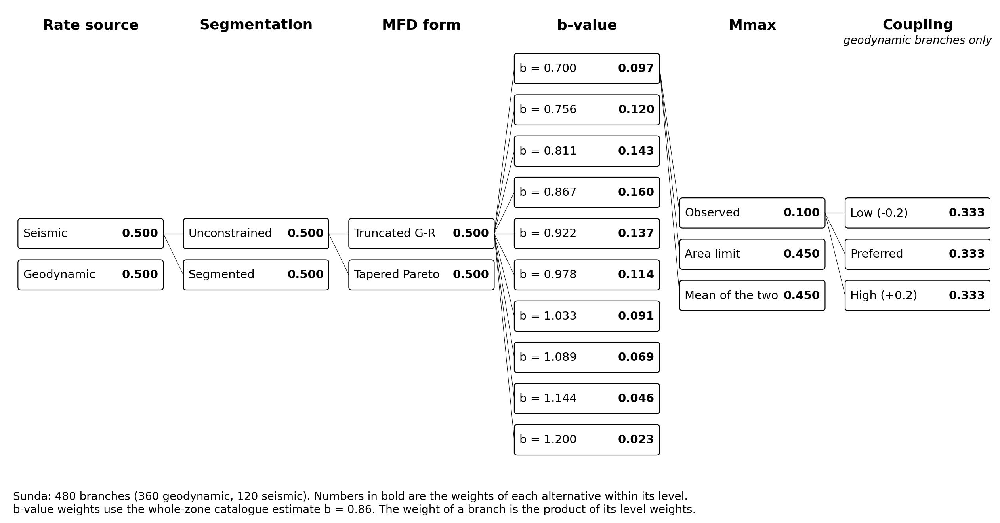
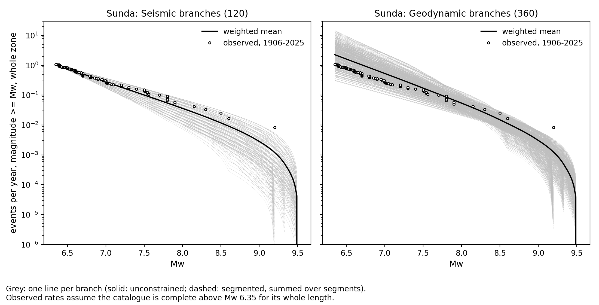
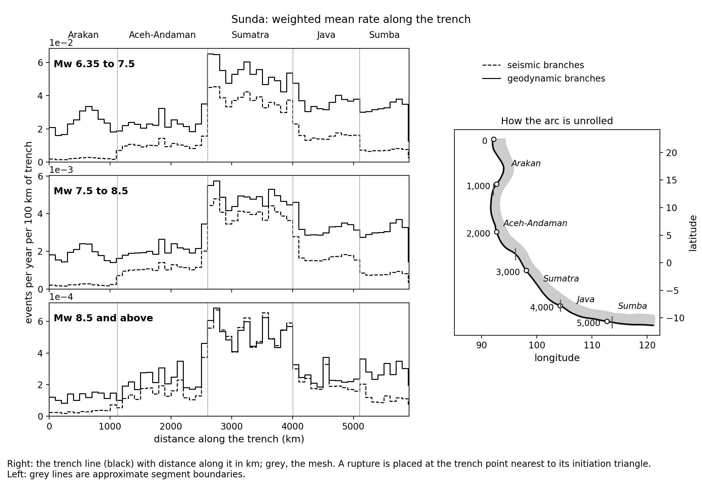
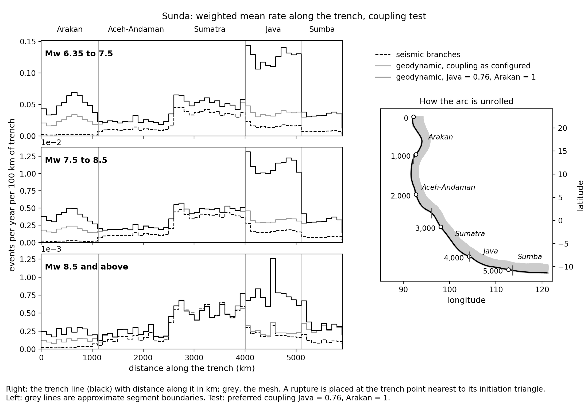
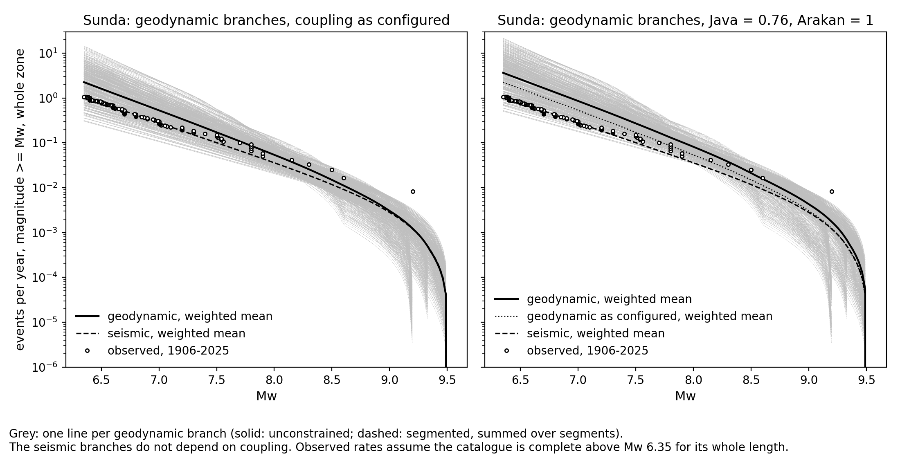

# PS scenario rates: guide

State: 15 November 2026. Sunda, first run. Makran not yet done.

Contents: 1 What this is · 2 Computing hazard from the rates · 3 Method in brief · 4 The logic tree ·
5 The steps · 6 Results for Sunda · 7 Sensitivity to coupling · 8 Decisions · 9 Open points on the inputs ·
10 What is not done yet

## 1. What this is

The tsunami simulations give, for every scenario, the wave height at each point of interest. A hazard curve
also needs the annual rate of every scenario. This folder computes that rate, on every branch of a logic tree
that carries the uncertainty in how often earthquakes of each magnitude occur and where.

Two independent ways of setting the rates are kept as branches:

- **Seismic**: the earthquake catalogue fixes how many events occur (the rate of Mw 6.35 and larger since 1906).
- **Geodynamic**: plate convergence and coupling fix how much moment must be released per year (the moment budget).

In both, a magnitude-frequency distribution (MFD) divides the total among magnitude bins, and a share rule
divides each bin's rate among the scenarios of that bin.

What is in the first run and what is not:

| | In this run |
|---|---|
| Zone | Sunda megathrust, five segments: Arakan, Aceh-Andaman, Sumatra, Java, Sumba |
| Scenarios | The 2,075,771 scenarios of rigidity model 00 (homogeneous, 30 GPa). The other rigidity models have no rate yet. |
| Magnitudes | 31 bins, Mw 6.35 to 9.52 |
| Branches | 480 (360 geodynamic, 120 seismic) |
| Weights | Set in the configuration; several are equal weights waiting for a decision. No Bayesian update yet. |

## 2. Computing hazard from the rates

Nothing but this folder is needed: the tables in `products/` are enough, the input data are not.

**Mean hazard curve.** Use the mean rate of each scenario over all branches:

```python
import numpy as np
from ptha_rates import rates

scen  = np.load("products/B1_inputs/scenarios_sunda.npz")
names = rates.scenario_names("sun", scen)                       # PS_sun_00_..., one per scenario
mean  = np.load("products/B7_rates/scenario_rates_sunda.npz")["rate_mean"]   # events per year, same order

# h[i] = tsunami height of scenario names[i] at one point of interest (from the simulations)
thresholds = np.logspace(-2, 1.3, 50)
annual_rate = np.array([mean[h >= x].sum() for x in thresholds])     # rate of exceedance
prob_50yr   = 1 - np.exp(-annual_rate * 50)                          # Poisson probability in 50 years
```

**Curve of one branch, and percentiles.** Replace `mean` by the rates of a branch and repeat for all 480:

```python
import pandas as pd
branches = pd.read_csv("products/B0_config/branch_table_sunda.csv")   # branch_id, alternative at each level, weight
D = rates.load("sunda")                                               # read the tables once
curves = []
for br in branches.itertuples():
    r = rates.position_rates(D, br)[scen["position"]] * scen["split"]  # rate of every scenario on this branch
    curves.append([r[h >= x].sum() for x in thresholds])
curves = np.array(curves)                                             # branch x threshold
# weighted mean over branches equals the curve from the mean rates; weighted percentiles give the epistemic spread
```

`rates.scenario_rates("sunda", branch_id)` returns the same for a single branch.

Things to know before using them:

- **Order.** Rates are in the order of `products/B1_inputs/scenarios_sunda.npz`. Match your simulation results to
  `names`; do not rely on the order of any other file. `products/B7_rates/scenario_mean_rates_sunda.csv.gz`
  has name and mean rate side by side.
- **Coverage.** Only scenarios of rigidity model 00 have a rate. A simulated scenario of another rigidity model must
  be left out, not given a zero.
- **Units.** Events per year. The rates of all scenarios add up to the total rate of Mw 6.35 and larger
  (1.66 per year in the mean).
- **Weights.** `weight` in the branch table sums to 1 over the 480 branches. The split between rigidity models
  and scaling laws is already inside the rate (they are pooled, not branches).
- **Means of groups.** `scenario_rates_sunda.npz` also holds the mean over the seismic, geodynamic, unconstrained and
  segmented branches (`rate_mean_seismic` and so on), for a quick view of what drives the hazard.
- **Provisional.** Section 5 lists what each step approximates and section 9 the open points on the inputs. Rates
  will change when those are settled; rerun and replace, do not patch.

The formula behind a rate, should you want to rebuild it from the tables yourself:

    rate(scenario, branch) = pooled weight x bin rate(branch) x share(position) x split(scenario)

| Table | File |
|---|---|
| Branches and weights | `products/B0_config/branch_table_sunda.csv` |
| Scenarios: parts of the name, bin, position, split | `products/B1_inputs/scenarios_sunda.npz` |
| Bin rates (unit x variant x form x b x Mmax x bin) | `products/B4_bin_rates/bin_rates_sunda.npz` |
| Shares, unconstrained branches (variant x position) | `products/B5_shares/shares_sunda.npz` |
| Shares, segmented branches (position x segment) | `products/B6_segmented/shares_segmented_sunda.npz` |

## 3. Method in brief

Terms:

- **Bin**: one of the magnitudes at which scenarios exist (31 for Sunda).
- **Position**: where and how a rupture is placed: rigidity model + scaling law + magnitude bin + initiation triangle.
  123,988 positions for Sunda.
- **Split**: a position usually has several scenarios (scaling samples and slip realisations). The position's rate is
  divided equally among those that exist.
- **Unit**: the whole zone, or one segment.
- **Moment budget**: sum over triangles of rigidity x area x coupling x convergence, in N m per year.

Bin rates:

- Geodynamic branches: the MFD shape (truncated Gutenberg-Richter or tapered Pareto, with the b-value and Mmax of
  the branch) is scaled so that the moment it releases above the smallest modelled magnitude equals that part of
  the budget.
- Seismic branches: the same shape is scaled so that the rate above Mw 6.35 equals the rate observed since 1906.

Where the rate goes:

- **Unconstrained** branches use one MFD for the whole zone. A bin's rate is shared among positions in proportion
  to the loading (geodynamic) or the density of observed events (seismic) under the rupture.
- **Segmented** branches use one MFD per segment. A rupture takes rate from each segment it touches in proportion
  to the fraction of its moment in that segment.

Each scenario then receives its position's rate times its split.

## 4. The logic tree



| Level | Alternatives | Weights | Note |
|---|---|---|---|
| Rate source | seismic, geodynamic | 0.5, 0.5 | Open; equal until decided |
| Segmentation | unconstrained, segmented | 0.5, 0.5 | |
| MFD form | truncated Gutenberg-Richter, tapered Pareto | 0.5, 0.5 | |
| b-value | 10 values, 0.7 to 1.2 | highest at the catalogue estimate (0.86), falling linearly | Same range for every zone and segment |
| Mmax | largest observed, area limit, mean of the two | 0.10, 0.45, 0.45 | Whole zone: 9.2, 9.5, 9.35 |
| Coupling (geodynamic only) | preferred - 0.2, preferred, preferred + 0.2, kept within 0.1 to 1 | equal | Open |

Rigidity model and scaling law (Strasser et al. 2010; Thingbaijam et al. 2017, equal weights) are pooled inside
each bin and are not branches. All of this is set in `config/logic_tree.yaml`; `figures/weights_panel_sunda.png`
shows the weights.

Segment values (`config/zones.yaml`):

| Segment | b | Coupling (low / preferred / high) | Convergence (mm/yr) | Mmax observed / area limit |
|---|---|---|---|---|
| Arakan | 0.866 | 0.25 / 0.45 / 0.65 | 18 | 7.5 / 9.4 |
| Aceh-Andaman | 0.876 | 0.50 / 0.70 / 0.90 | 25 | 9.2 / 9.5 |
| Sumatra | 0.787 | 0.60 / 0.80 / 1.00 | 39 | 8.6 / 9.4 |
| Java | 0.881 | 0.10 / 0.176 / 0.376 | 68 | 7.8 / 9.3 |
| Sumba | 1.028 | 0.10 / 0.20 / 0.40 | 67 | 8.3 / 9.2 |

## 5. The steps

One run script per step (`scripts/run_B<n>_<name>.py`); each writes `products/<step>/` and a check report.

| Step | What it does | Main products | Limitation in this run | Improvement |
|---|---|---|---|---|
| B0 Configuration | Reads and validates the two configuration files; builds the 480 branches with their weights | `branch_table`, logic tree figure, weights panel | Weights of rate source and coupling levels are equal by default | Agreed weights; Bayesian update against the record |
| B1 Input tables | Reads the scenario table and the mesh; assigns bins, positions, splits; gives every triangle a segment and a distance along the trench | `scenarios.npz`, `bins`, `triangles`, `trench` | Bin edges are midpoints between bin centres. The triangle-to-segment map is derived from the smallest scenarios (approximate at boundaries). Realisations per rupture are uneven (1 to 10). | Bin edges and segment table from the scenario provider |
| B2 Loading and budget | Coupling x convergence per triangle; moment budget per segment and for the zone at three coupling levels | `budget` | Coupling and convergence are constant inside a segment. Convergence is used as given (not projected onto the interface). One rigidity (30 GPa). | Values per triangle; a budget per rigidity model |
| B3 Catalogue | Assigns catalogue events to segments; counts events above the anchor magnitude; largest observed event per unit | `parameters`, catalogue fit figure | Events go to the segment of the nearest triangle with no depth or mechanism filter. Arakan (3 events) and Sumba (8) have uncertain anchor rates. b and Mc are taken from the source characterisation, not refitted. | Interface-only catalogue; uncertainty on the anchor rate as a branch |
| B4 Bin rates | Annual rate of every bin for every unit, rate variant, MFD form, b-value and Mmax | `bin_rates.npz`, MFD figure, modelled against observed large events | The tapered Pareto is cut at the top of the last bin (no scenarios above Mw 9.52). In segments with no large event on record, the "largest observed" Mmax forces the whole budget into moderate events. | Review the Mmax alternatives for quiet segments; decide the tail treatment |
| B5 Shares, unconstrained | Share of each bin's rate for every position, for the seismic variant and the three coupling levels | `shares.npz` | Rupture footprints are not available: loading under a rupture is taken from its segment fractions, so inside a segment all positions of a bin get the same weight | Footprint-based shares (needs a reduction of the slip files on the provider's side) |
| B6 Shares, segmented | Share of each segment's bin rate for every position, including ruptures that cross a boundary | `shares_segmented.npz` | No penalty on boundary-crossing ruptures (`crossing_penalty: 1`). Same shares for all rate variants, for the reason given under B5. | Penalty from evidence on segment boundaries, if wanted |
| B7 Scenario rates | Mean rate of every scenario over all branches and over four groups; reader for any single branch | `scenario_rates.npz`, `scenario_mean_rates.csv.gz` | Rates per branch are rebuilt on request, not stored (480 x 2 million values) | |
| B8 End-to-end checks | Rate conserved in every bin on every branch; moment released against the budget, in total and per segment; events per segment against the catalogue; rate along the trench | check report, rate-along-trench figure | Reports, does not correct | |

The unit tests (`python -m unittest discover tests`) check the building blocks on small cases with known answers.

## 6. Results for Sunda

All numbers are from the run of 15 November 2026 and change with the configuration.

**Budget.** 4.4, 6.6 and 9.7 x 10^20 N m per year at low, preferred and high coupling (preferred: one Mw 9.0 per
61 years). Shares of the preferred budget: Sumatra 43%, Aceh-Andaman 24%, Java 13%, Sumba 11%, Arakan 9%.
Whole-zone coupling is 0.28 / 0.42 / 0.62; the seismic branches imply 0.39 on average.

**Large events in 120 years** (the length of the catalogue), weighted mean over branches, 5% to 95% of branches in brackets:

| | Mw >= 7.5 | Mw >= 8 | Mw >= 8.5 | Mw >= 9 |
|---|---|---|---|---|
| Observed, 1906 to 2025 | 18 | 5 | 3 | 1 |
| Seismic, unconstrained | 12.2 (6.1 to 19.2) | 4.5 (1.6 to 8.1) | 1.5 (0.4 to 3.2) | 0.4 (0.1 to 1.0) |
| Seismic, segmented | 11.9 (6.1 to 19.1) | 4.2 (1.6 to 8.0) | 1.3 (0.3 to 3.0) | 0.3 (0.0 to 0.8) |
| Geodynamic, unconstrained | 16.3 (7.3 to 29.9) | 5.5 (2.9 to 9.1) | 1.8 (1.0 to 2.8) | 0.4 (0.2 to 0.7) |
| Geodynamic, segmented | 24.9 (8.8 to 51.4) | 7.5 (3.4 to 14.3) | 1.8 (1.0 to 2.9) | 0.3 (0.1 to 0.7) |
| All branches | 16.3 (6.8 to 35.2) | 5.4 (2.0 to 10.0) | 1.6 (0.4 to 3.0) | 0.4 (0.0 to 0.8) |



**Mean over all branches.** 1.66 events per year of Mw 6.35 and larger (seismic branches 1.06, geodynamic 2.25).
Mw >= 7.64 once per 10 years; Mw >= 8.44 once per 64 years; Mw >= 8.99 once per 332 years; Mw >= 9.26 once per
1,150 years.

**Where the rate falls.** Events per year by segment, weighted mean:

| Segment | Seismic branches | Geodynamic branches | Observed (Mw >= 6.35) |
|---|---|---|---|
| Arakan | 0.026 | 0.29 | 0.025 |
| Aceh-Andaman | 0.18 | 0.39 | 0.18 |
| Sumatra | 0.59 | 0.83 | 0.60 |
| Java | 0.20 | 0.44 | 0.19 |
| Sumba | 0.068 | 0.31 | 0.067 |



The geodynamic branches give more moderate events than the record in every segment, most of all in Arakan (about
eleven times) and Sumba (about five times). The main cause is the "largest observed" and "mean" Mmax alternatives
in segments whose record holds no large event (step B4 in section 5).

**Consistency.** Rate is conserved in every bin on every branch (relative error below 10^-12). The scenarios
release 1.3% more moment than the MFD assigns, because a scenario carries the moment of its bin centre. Moment
released in each segment against its budget (1 = balanced): 0.88 to 1.25 on the unconstrained branches, 0.95 to
1.17 on the segmented ones; Java is highest in both, as large ruptures centred in Sumatra extend into it.

## 7. Sensitivity to coupling

The coupling of Java and Arakan in Table 1 of the source characterisation is 0.76 and 1.00. With those values the
geodynamic branches gave several times more moderate events in the two segments than the catalogue holds, so the
configuration uses 0.176 and 0.45, for which coupling x convergence equals the preferred coupled convergence of
Davies et al. (2018) (12 and 8.1 mm/yr). The Table 1 values are kept as a sensitivity test:

```
python scripts/sens_coupling.py sunda Java=0.76 Arakan=1.0
```

| | Configuration | Table 1 coupling |
|---|---|---|
| Preferred budget (N m/yr) | 6.6 x 10^20 | 1.01 x 10^21 |
| Whole-zone coupling, preferred | 0.42 | 0.65 |
| Geodynamic unconstrained, events in 120 years (Mw >= 7.5 / 8 / 8.5 / 9) | 16.3 / 5.5 / 1.8 / 0.4 | 24.0 / 8.1 / 2.6 / 0.6 |
| Geodynamic segmented, same | 24.9 / 7.5 / 1.8 / 0.3 | 41.1 / 11.5 / 2.5 / 0.4 |
| Geodynamic rate in Java (events per year) | 0.44 | 1.50 |
| Geodynamic rate in Arakan | 0.29 | 0.60 |
| All branches, Mw >= 6.35 per year | 1.66 | 2.35 |





The test recomputes budget, bin rates and shares in memory and writes to `products/sensitivity/`; nothing in the
configuration or the main products changes. Any segment and value can be tested the same way.

## 8. Decisions

Taken by the lead of this work; open to review by the group. The numbers are those used in the code and the configuration.

| # | Question | Decision | Status |
|---|---|---|---|
| 1 | Weights of seismic against geodynamic | Equal, both kept | Open |
| 2 | b-values | Ten values over 0.7 to 1.2 for every unit; weight falls linearly with distance from the catalogue estimate | Decided |
| 3 | Low and high coupling | Preferred -/+ 0.2, floor 0.1, ceiling 1; equal weights | Decided; weights open |
| 4 | Rigidity model and scaling law | Pooled inside the bin with equal weights; not branches | Decided |
| 5 | Bin edges | Midpoints between bin centres | Stand-in |
| 6 | Convergence | Used as given; not projected onto the interface | Decided |
| 7 | Tapered Pareto corner | Equal to the Mmax alternative of the branch | Decided |
| 8 | Smallest magnitude for the budget | Lower edge of the first bin | Decided |
| 9 | Rupture footprints | Segment-fraction approximation in the first run | Decided |
| 10 | Scaling sample 00 | Counted as one sample among the others | Decided |
| 11 | Zero-slip triangles in a footprint | Not needed for the first run | Open |
| 12 | Output for the hazard calculation | Bin rates and shares for all branches, with a reader | Decided |
| 13 | Weight updating | Product of the level weights; no Bayesian update; modelled against observed reported only | Decided |
| 14 | Rigidity models | Homogeneous model only in the first run | Decided |
| 15 | b-value weight on segmented branches | From the whole-zone estimate | Decided |
| 16 | Sunda whole-zone area-limit Mmax | 9.5 | Decided |
| 17 | Segment Mmax | Area limit from the source characterisation; observed from the catalogue; third value their mean | Decided |
| 18 | First and last bins | Symmetric about their centres | Decided |
| 19 | Position | Rigidity model + scaling law + magnitude bin + initiation triangle | Decided |
| 20 | Seismic anchor | Observed rate of Mw >= 6.35 since 1906, per unit. The rate at the completeness magnitude since 2000 is not used: that period holds the 2004 to 2012 cluster. | Decided |
| 21 | Coupling of Java and Arakan | 0.176 and 0.45 (section 7); Table 1 values kept as a sensitivity test | Decided 15 Nov 2026 |

Choices made in the code and not yet confirmed: the tapered Pareto is cut at the top of the last bin with the
budget balanced over the modelled bins (`tapered_tail`); catalogue events are assigned to the nearest segment
without a filter; the seismic shares use events above the anchor per km2 of segment.

## 9. Open points on the inputs

Found while checking the scenario tables. None stops the run; each may change the rates when answered.

| # | Point | Effect |
|---|---|---|
| H1 | In the one slip sample checked (Mw 9.03), slip x area x 30 GPa is about 12% below the named moment for ruptures centred south of 8°S (Java, Sumba) | Tsunami sources there may carry less moment than the bin they get a rate for |
| H2 | 6% of Sunda scenarios have a total moment 0.01 to 0.07 magnitude units above the named magnitude (mostly slip realisation 000, Mw 7.93 and below) | No scenario changes bin; about 0.3% in the moment balance |
| H3 | Segment fractions of boundary-crossing ruptures changed between the two versions of the fractions file | To be confirmed as moment fractions; a triangle-to-segment table would allow an independent check |
| H4 | Realisations are uneven: most rupture geometries have one slip realisation, others ten; scaling samples per triangle vary from 1 to 10 | The split uses the counts that exist |
| H5 | Stand-ins: bin edges, segment map, per-segment coupling and convergence, footprints | Replace and rerun B1, B2, B5 |
| H6 | Values still missing for Makran and for the whole-zone entries | Needed before the Makran run |
| H7 | The method document of the work package gives branch counts for three b-values (with ten there are 360 and 120) and Mw 6.0 as the smallest magnitude (Sunda scenarios start at the Mw 6.5 bin) | To be corrected there |
| H8 | Open decisions 1 and 11 and the coupling weights | Equal weights until settled |
| H9 | Depth-dependent rigidity models | Need the rigidity profiles; then a budget per model |

## 10. What is not done yet

- **Makran.** The code takes any zone listed in `config/zones.yaml`. Makran needs its mesh as a text file, a
  catalogue, and the coupling and Mmax values that are still empty there. Then `python scripts/run_all.py makran`.
- **Depth-dependent rigidity models** (01 to 03): set their weights under `event_tree: rigidity_model` once a
  budget per model is coded.
- **Shares from rupture footprints**, replacing the segment-fraction approximation. The code is organised so that
  only the weight calculation in `ptha_rates/shares.py` changes.
- **Weights from data** (Bayesian update against the record of large events).
- **Background seismicity** is outside this folder.
