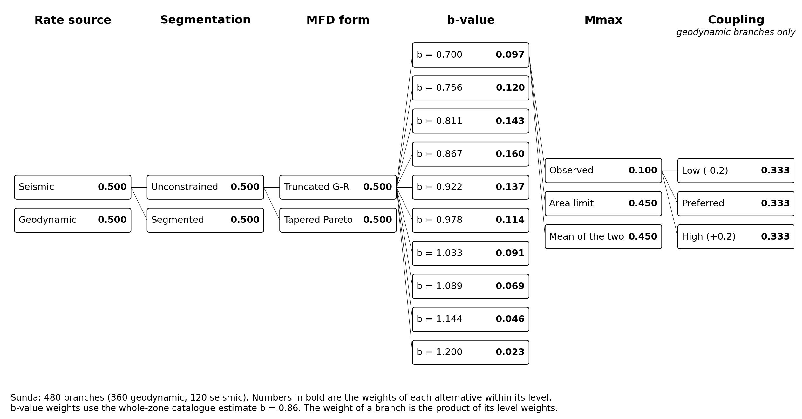
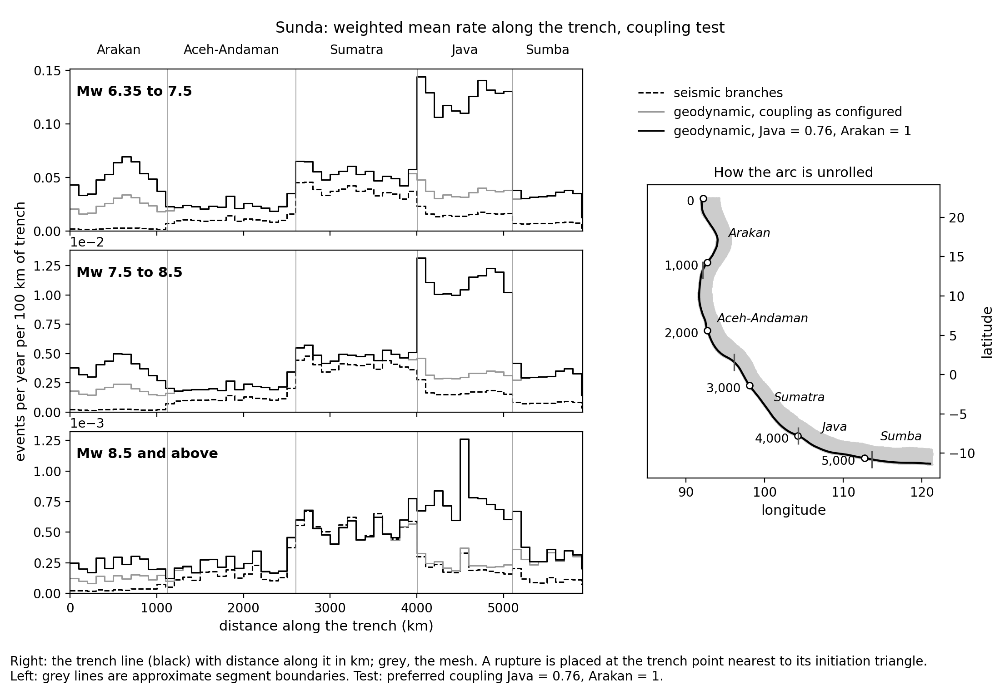

# Results

Version 1.0 of the rates. Written by `scripts/make_results.py` from the products of the run; not edited by hand.
What the quantities mean, the limitations of each step and the decisions behind the inputs are in `guide.md`.

## Sunda

2,075,771 scenarios in 123,988 rupture positions; 31 magnitude bins, Mw 6.35 to 9.52; 480 branches (360 geodynamic, 120 seismic).

Checks of this run: 38 passed, 0 failed, 38 reported for information (`checks/INDEX.md`).

### Configuration used

Placement of the rate among rupture positions (`footprints`): segment fraction approximation.

Weights of the logic tree (`config/logic_tree.yaml`):

| Level | Alternatives and weights |
|---|---|
| rate source | seismic 0.5, geodynamic 0.5 |
| segmentation | unconstrained 0.5, segmented 0.5 |
| mfd form | truncated gr 0.5, tapered pareto 0.5 |
| b-value | 0.70: 0.097, 0.76: 0.120, 0.81: 0.143, 0.87: 0.160, 0.92: 0.137, 0.98: 0.114, 1.03: 0.091, 1.09: 0.069, 1.14: 0.046, 1.20: 0.023 |
| mmax | observed 0.1, area limit 0.45, mean 0.45 |
| coupling (geodynamic) | low 0.333, preferred 0.333, high 0.333 |

Zone and segment values (`config/zones.yaml`; Mmax observed from the catalogue):

| Unit | b | Coupling low / preferred / high | Convergence (mm/yr) | Mmax observed / area limit / mean | Events of Mw >= 6.35 since 1906 |
|---|---|---|---|---|---|
| whole zone | 0.860 | 0.284 / 0.422 / 0.622 | 41 | 9.2 / 9.5 / 9.35 | 127 |
| Arakan | 0.866 | 0.25 / 0.45 / 0.65 | 18 | 7.5 / 9.4 / 8.45 | 3 |
| Aceh-Andaman | 0.876 | 0.5 / 0.7 / 0.9 | 25 | 9.2 / 9.5 / 9.35 | 21 |
| Sumatra | 0.787 | 0.6 / 0.8 / 1 | 39 | 8.6 / 9.4 / 9.00 | 72 |
| Java | 0.881 | 0.1 / 0.176 / 0.376 | 68 | 7.8 / 9.3 / 8.55 | 23 |
| Sumba | 1.028 | 0.1 / 0.2 / 0.4 | 67 | 8.3 / 9.2 / 8.75 | 8 |

### Moment budget

| Unit | Low (N m/yr) | Preferred | High | Share of the preferred budget |
|---|---|---|---|---|
| whole zone | 4.42e+20 | 6.58e+20 | 9.7e+20 | 100% |
| Arakan | 3.39e+19 | 6.1e+19 | 8.81e+19 | 9% |
| Aceh-Andaman | 1.11e+20 | 1.55e+20 | 2e+20 | 24% |
| Sumatra | 2.13e+20 | 2.84e+20 | 3.55e+20 | 43% |
| Java | 4.76e+19 | 8.38e+19 | 1.79e+20 | 13% |
| Sumba | 3.72e+19 | 7.43e+19 | 1.49e+20 | 11% |

### Large events in 120 years

Weighted mean over the branches of each group, with the 5% to 95% range of branches in brackets. Reported only; no weight is changed.

|  | Mw >= 7.5 | Mw >= 8 | Mw >= 8.5 | Mw >= 9 |
|---|---|---|---|---|
| Observed | 18 | 5 | 3 | 1 |
| Seismic, unconstrained | 12.2 (6.1 to 19.2) | 4.5 (1.6 to 8.1) | 1.5 (0.4 to 3.2) | 0.4 (0.1 to 1.0) |
| Seismic, segmented | 11.9 (6.1 to 19.1) | 4.2 (1.6 to 8.0) | 1.3 (0.3 to 3.0) | 0.3 (0.0 to 0.8) |
| Geodynamic, unconstrained | 16.3 (7.3 to 29.9) | 5.5 (2.9 to 9.1) | 1.8 (1.0 to 2.8) | 0.4 (0.2 to 0.7) |
| Geodynamic, segmented | 24.9 (8.8 to 51.4) | 7.5 (3.4 to 14.3) | 1.8 (1.0 to 2.9) | 0.3 (0.1 to 0.7) |
| All branches | 16.3 (6.8 to 35.2) | 5.4 (2.0 to 10.0) | 1.6 (0.4 to 3.0) | 0.4 (0.0 to 0.8) |

### Mean rate of the zone

Weighted mean over all branches.

| Magnitude | Rate |
|---|---|
| Mw >= 6.35 | 1.66 per year |
| Mw >= 7.20 | once per 4 years |
| Mw >= 7.64 | once per 10 years |
| Mw >= 8.01 | once per 23 years |
| Mw >= 8.56 | once per 87 years |
| Mw >= 9.06 | once per 424 years |
| Mw >= 9.26 | once per 1,153 years |

Total rate of modelled events: seismic branches 1.06 per year; geodynamic branches 2.25 per year.

### Where the rate falls

Events per year by segment, weighted mean. A rupture's rate is divided between segments by its segment fractions.

| Segment | Seismic branches | Geodynamic branches | Observed (Mw >= 6.35) |
|---|---|---|---|
| Arakan | 0.026 | 0.291 | 0.025 |
| Aceh-Andaman | 0.177 | 0.389 | 0.175 |
| Sumatra | 0.594 | 0.833 | 0.600 |
| Java | 0.195 | 0.436 | 0.192 |
| Sumba | 0.068 | 0.306 | 0.067 |

### Consistency

Moment released by the scenarios against the moment the MFD assigns: 1.013 (a scenario carries the moment of its bin centre: 1.011 from that alone).

Moment released in each segment against its budget, geodynamic branches (1 = balanced):

| Segment | Unconstrained | Segmented |
|---|---|---|
| Arakan | 1.05 | 1.16 |
| Aceh-Andaman | 1.05 | 1.00 |
| Sumatra | 0.88 | 0.95 |
| Java | 1.25 | 1.17 |
| Sumba | 1.14 | 1.04 |

### Other figures

## Sensitivity tests

In each test "now" or "present" is the configuration and "test" the changed input. The lines about file names refer to `products/sensitivity/`.

### Sensitivity test: coupling Java = 0.76, Arakan = 1 (sunda)

Nothing in the configuration or in the products of steps B0 to B4 was changed. Low and high coupling follow the usual rule (preferred -/+ 0.2, within 0.1 to 1).

#### Preferred coupling and budget

| Unit | Coupling now | Coupling in test | Budget now (N m/yr) | Budget in test | Ratio |
|---|---|---|---|---|---|
| whole_zone | 0.42 | 0.65 | 6.579e+20 | 1.010e+21 | 1.54 |
| Arakan | 0.45 | 1.00 | 6.097e+19 | 1.355e+20 | 2.22 |
| Aceh-Andaman | 0.70 | 0.70 | 1.552e+20 | 1.552e+20 | 1.00 |
| Sumatra | 0.80 | 0.80 | 2.836e+20 | 2.836e+20 | 1.00 |
| Java | 0.18 | 0.76 | 8.379e+19 | 3.618e+20 | 4.32 |
| Sumba | 0.20 | 0.20 | 7.430e+19 | 7.430e+19 | 1.00 |

#### Events in 120 years, weighted mean over branches

| Group | Case | Rate at Mw >= 6.35 (per yr) | Mw >= 7.5 | Mw >= 8 | Mw >= 8.5 | Mw >= 9 |
|---|---|---|---|---|---|---|
| Observed | | 1.06 | 18 | 5 | 3 | 1 |
| geodynamic, unconstrained | present | 1.72 | 16.3 | 5.5 | 1.8 | 0.4 |
| geodynamic, unconstrained | test | 2.53 | 24.0 | 8.1 | 2.6 | 0.6 |
| geodynamic, segmented | present | 2.78 | 24.9 | 7.5 | 1.8 | 0.3 |
| geodynamic, segmented | test | 4.76 | 41.1 | 11.5 | 2.5 | 0.4 |
| seismic | present | 1.06 | 12.1 | 4.3 | 1.4 | 0.3 |
| seismic | test | 1.06 | 12.1 | 4.3 | 1.4 | 0.3 |
| all branches | present | 1.66 | 16.3 | 5.4 | 1.6 | 0.4 |
| all branches | test | 2.35 | 22.3 | 7.1 | 2.0 | 0.4 |

#### Rate by segment, weighted mean over branches (all modelled magnitudes per year; Mw >= 7.5 in 120 years)

| Segment | Seismic | Geodynamic now | Geodynamic in test | Seismic, Mw >= 7.5 | Geodynamic now, Mw >= 7.5 | Geodynamic in test, Mw >= 7.5 |
|---|---|---|---|---|---|---|
| Arakan | 0.026 | 0.291 | 0.601 | 0.4 | 2.7 | 5.4 |
| Aceh-Andaman | 0.177 | 0.389 | 0.390 | 2.4 | 4.3 | 4.4 |
| Sumatra | 0.594 | 0.833 | 0.838 | 7.6 | 9.0 | 9.2 |
| Java | 0.195 | 0.436 | 1.505 | 2.6 | 4.6 | 15.6 |
| Sumba | 0.068 | 0.306 | 0.312 | 0.9 | 3.5 | 3.7 |

A rupture's rate is divided between segments by its segment fractions. rate_along_trench.png shows the same along the trench.

mfd.png: cumulative rates of the whole zone on every geodynamic branch, as configured and in the test. mfd_segments.png: the same for each segment that was changed (segmented branches).

