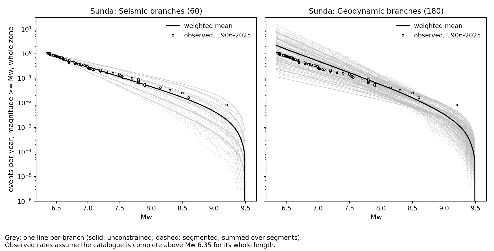
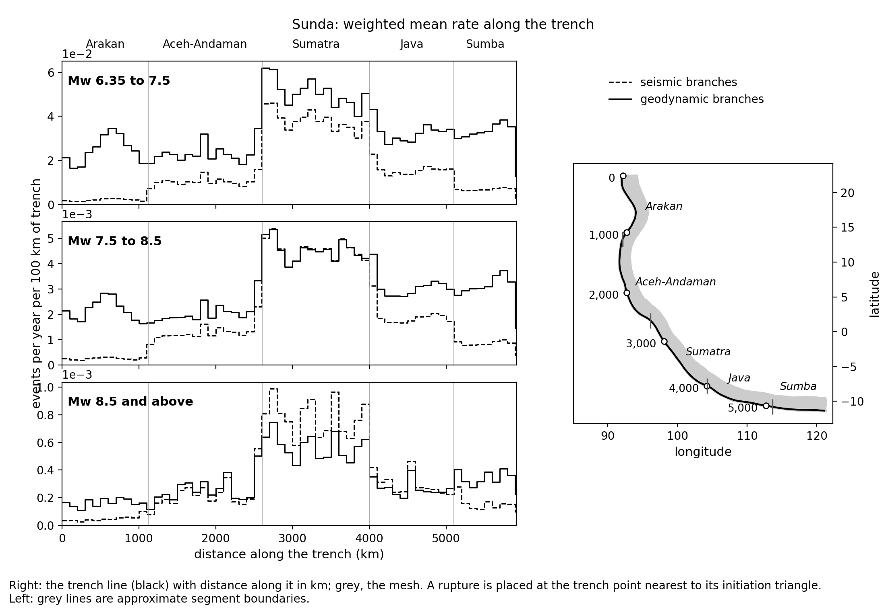
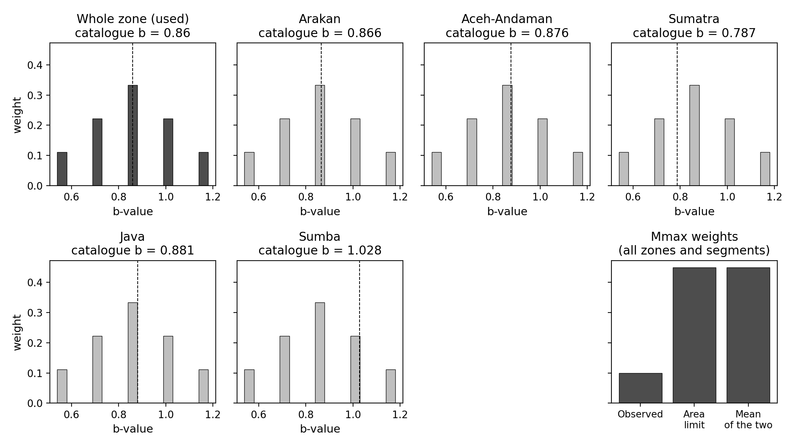
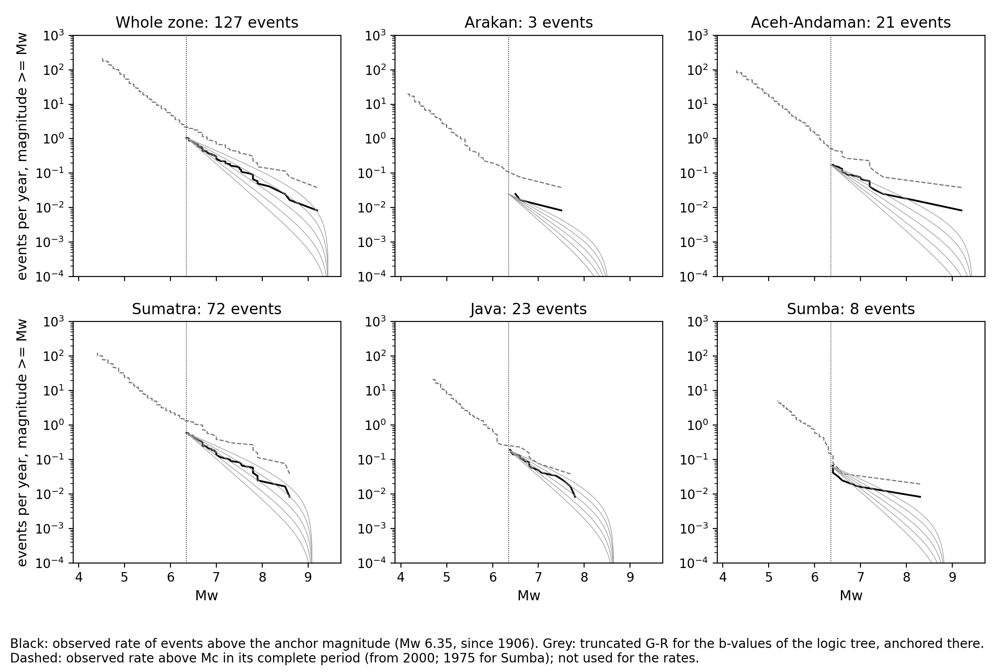
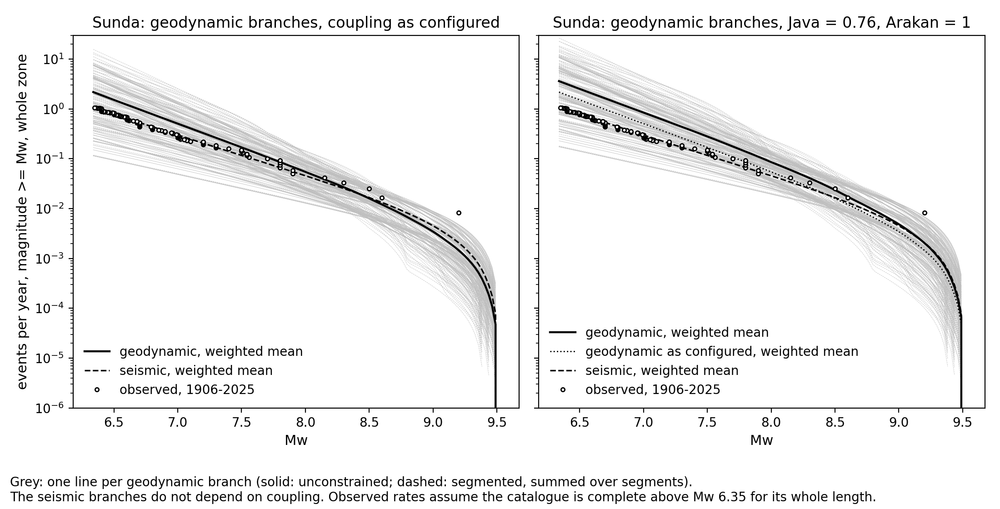
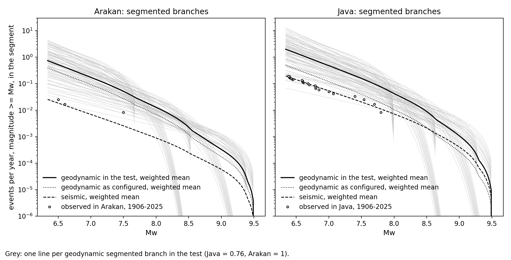

# Results

Version 1.1 of the rates. Written by `scripts/make_results.py` from the products of the run; not edited by hand.
What the quantities mean, the limitations of each step and the decisions behind the inputs are in `guide.md`.

## Sunda

2,075,771 scenarios in 123,988 rupture positions; 31 magnitude bins, Mw 6.34 to 9.52; 240 branches (180 geodynamic, 60 seismic).

Checks of this run: 49 passed, 0 failed, 44 reported for information (`checks/INDEX.md`).

### Configuration used

Placement of the rate among rupture positions (`footprints`): segment fraction approximation.

Rigidity models in use (pooled): 00 1; left out for want of footprints with slip: 01.

Weights of the logic tree (`config/logic_tree.yaml`):

| Level | Alternatives and weights |
|---|---|
| rate source | seismic 0.4, geodynamic 0.6 |
| segmentation | unconstrained 0.4, segmented 0.6 |
| mfd form | truncated gr 0.5, tapered pareto 0.5 |
| b-value | 0.56: 0.111, 0.71: 0.222, 0.86: 0.333, 1.01: 0.222, 1.16: 0.111 |
| mmax | observed 0.1, area limit 0.45, mean 0.45 |
| coupling (geodynamic) | low 0.250, preferred 0.500, high 0.250 |

Zone and segment values (`config/zones.yaml`; Mmax observed = largest event in the catalogue + 0.2, at most the area limit):

| Unit | b | Coupling low / preferred / high | Convergence (mm/yr) | Mmax observed / area limit / mean | Events of Mw >= 6.35 since 1906 |
|---|---|---|---|---|---|
| whole zone | 0.860 | 0.208 / 0.408 / 0.738 | 42 | 9.4 / 9.5 / 9.45 | 127 |
| Arakan | 0.866 | 0.225 / 0.45 / 0.9 | 18 | 7.7 / 9.4 / 8.55 | 3 |
| Aceh-Andaman | 0.876 | 0.35 / 0.7 / 1.3 | 25 | 9.4 / 9.5 / 9.45 | 21 |
| Sumatra | 0.787 | 0.4 / 0.8 / 1.3 | 39 | 8.8 / 9.4 / 9.10 | 72 |
| Java | 0.881 | 0.1 / 0.176 / 0.352 | 68 | 8.0 / 9.3 / 8.65 | 23 |
| Sumba | 1.028 | 0.1 / 0.2 / 0.4 | 67 | 8.5 / 9.2 / 8.85 | 8 |

### Moment budget

| Unit | Low (N m/yr) | Preferred | High | Share of the preferred budget |
|---|---|---|---|---|
| whole zone | 3.47e+20 | 6.82e+20 | 1.23e+21 | 100% |
| Arakan | 3.04e+19 | 6.08e+19 | 1.22e+20 | 9% |
| Aceh-Andaman | 7.73e+19 | 1.55e+20 | 2.87e+20 | 23% |
| Sumatra | 1.44e+20 | 2.87e+20 | 4.67e+20 | 42% |
| Java | 5.12e+19 | 9.02e+19 | 1.8e+20 | 13% |
| Sumba | 4.44e+19 | 8.88e+19 | 1.78e+20 | 13% |

### Large events in 120 years

Weighted mean over the branches of each group, with the 5% to 95% range of branches in brackets. Reported only; no weight is changed.

|  | Mw >= 7.5 | Mw >= 8 | Mw >= 8.5 | Mw >= 9 |
|---|---|---|---|---|
| Observed | 18 | 5 | 3 | 1 |
| Seismic, unconstrained | 14.2 (5.9 to 28.2) | 5.6 (1.5 to 14.4) | 2.2 (0.4 to 7.0) | 0.7 (0.1 to 2.8) |
| Seismic, segmented | 13.9 (5.8 to 28.4) | 5.3 (1.5 to 14.4) | 1.9 (0.3 to 6.4) | 0.4 (0.0 to 1.7) |
| Geodynamic, unconstrained | 15.3 (4.6 to 33.3) | 5.3 (2.0 to 10.2) | 1.8 (0.8 to 3.1) | 0.5 (0.2 to 1.0) |
| Geodynamic, segmented | 23.6 (6.5 to 53.1) | 7.4 (2.7 to 16.3) | 2.0 (0.8 to 3.8) | 0.4 (0.1 to 0.9) |
| All branches | 17.8 (5.9 to 40.8) | 6.1 (1.6 to 13.9) | 1.9 (0.5 to 4.0) | 0.5 (0.1 to 1.1) |

### Mean rate of the zone

Weighted mean over all branches.

| Magnitude | Rate |
|---|---|
| Mw >= 6.34 | 1.74 per year |
| Mw >= 7.22 | once per 4 years |
| Mw >= 7.67 | once per 10 years |
| Mw >= 8.03 | once per 21 years |
| Mw >= 8.58 | once per 76 years |
| Mw >= 9.08 | once per 355 years |
| Mw >= 9.26 | once per 796 years |

Total rate of modelled events: seismic branches 1.08 per year; geodynamic branches 2.18 per year.

### Where the rate falls

Events per year by segment, weighted mean. A rupture's rate is divided between segments by its segment fractions.

| Segment | Seismic branches | Geodynamic branches | Observed (Mw >= 6.35) |
|---|---|---|---|
| Arakan | 0.027 | 0.303 | 0.025 |
| Aceh-Andaman | 0.183 | 0.384 | 0.175 |
| Sumatra | 0.612 | 0.786 | 0.600 |
| Java | 0.195 | 0.394 | 0.192 |
| Sumba | 0.066 | 0.309 | 0.067 |

### Consistency

Moment released by the scenarios against the moment the MFD assigns: 1.002 (a scenario carries the moment of its bin centre: 1.000 from that alone).

Moment released in each segment against its budget, geodynamic branches (1 = balanced):

| Segment | Unconstrained | Segmented |
|---|---|---|
| Arakan | 1.06 | 1.14 |
| Aceh-Andaman | 1.09 | 0.99 |
| Sumatra | 0.88 | 0.93 |
| Java | 1.21 | 1.16 |
| Sumba | 0.97 | 1.01 |

### Other figures

## Sensitivity tests

In each test "now" or "present" is the configuration and "test" the changed input. The lines about file names refer to `products/sensitivity/`.

### Sensitivity test: coupling Java = 0.76, Arakan = 1 (sunda)

Nothing in the configuration or in the products of steps B0 to B4 was changed. Low and high coupling follow the coupling rule of the logic tree (decision 25).

#### Preferred coupling and budget

| Unit | Coupling now | Coupling in test | Budget now (N m/yr) | Budget in test | Ratio |
|---|---|---|---|---|---|
| whole_zone | 0.41 | 0.63 | 6.816e+20 | 1.055e+21 | 1.55 |
| Arakan | 0.45 | 1.00 | 6.076e+19 | 1.350e+20 | 2.22 |
| Aceh-Andaman | 0.70 | 0.70 | 1.546e+20 | 1.546e+20 | 1.00 |
| Sumatra | 0.80 | 0.80 | 2.874e+20 | 2.874e+20 | 1.00 |
| Java | 0.18 | 0.76 | 9.015e+19 | 3.893e+20 | 4.32 |
| Sumba | 0.20 | 0.20 | 8.875e+19 | 8.875e+19 | 1.00 |

#### Events in 120 years, weighted mean over branches

| Group | Case | Rate at Mw >= 6.34 (per yr) | Mw >= 7.5 | Mw >= 8 | Mw >= 8.5 | Mw >= 9 |
|---|---|---|---|---|---|---|
| Observed | | 1.06 | 18 | 5 | 3 | 1 |
| geodynamic, unconstrained | present | 1.65 | 15.3 | 5.3 | 1.8 | 0.5 |
| geodynamic, unconstrained | test | 2.47 | 23.0 | 7.9 | 2.7 | 0.7 |
| geodynamic, segmented | present | 2.53 | 23.6 | 7.4 | 2.0 | 0.4 |
| geodynamic, segmented | test | 4.38 | 40.6 | 11.9 | 2.9 | 0.5 |
| seismic | present | 1.08 | 14.0 | 5.5 | 2.0 | 0.5 |
| seismic | test | 1.08 | 14.0 | 5.5 | 2.0 | 0.5 |
| all branches | present | 1.74 | 17.8 | 6.1 | 1.9 | 0.5 |
| all branches | test | 2.60 | 25.8 | 8.4 | 2.5 | 0.6 |

#### Rate by segment, weighted mean over branches (all modelled magnitudes per year; Mw >= 7.5 in 120 years)

| Segment | Seismic | Geodynamic now | Geodynamic in test | Seismic, Mw >= 7.5 | Geodynamic now, Mw >= 7.5 | Geodynamic in test, Mw >= 7.5 |
|---|---|---|---|---|---|---|
| Arakan | 0.027 | 0.303 | 0.567 | 0.4 | 3.1 | 5.8 |
| Aceh-Andaman | 0.183 | 0.384 | 0.386 | 2.8 | 4.2 | 4.3 |
| Sumatra | 0.612 | 0.786 | 0.795 | 8.9 | 8.5 | 8.8 |
| Java | 0.195 | 0.394 | 1.549 | 2.9 | 4.4 | 16.9 |
| Sumba | 0.066 | 0.309 | 0.316 | 1.0 | 3.5 | 3.8 |

A rupture's rate is divided between segments by its segment fractions. rate_along_trench.png shows the same along the trench.

mfd.png: cumulative rates of the whole zone on every geodynamic branch, as configured and in the test. mfd_segments.png: the same for each segment that was changed (segmented branches).

